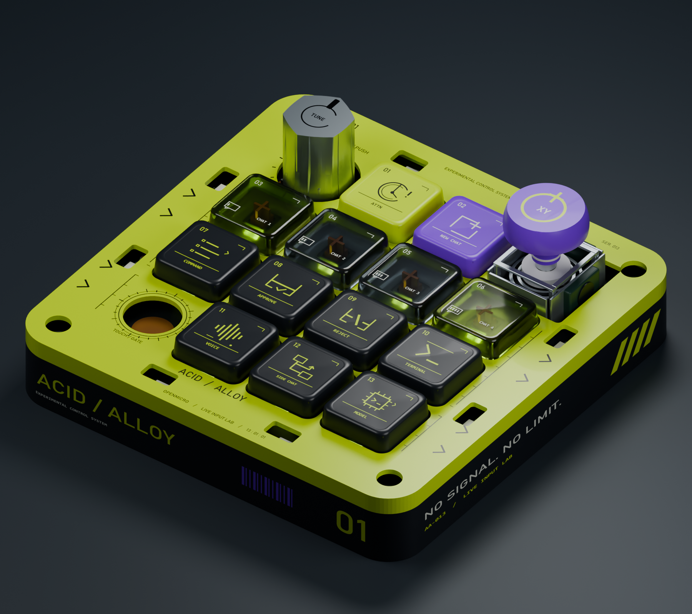
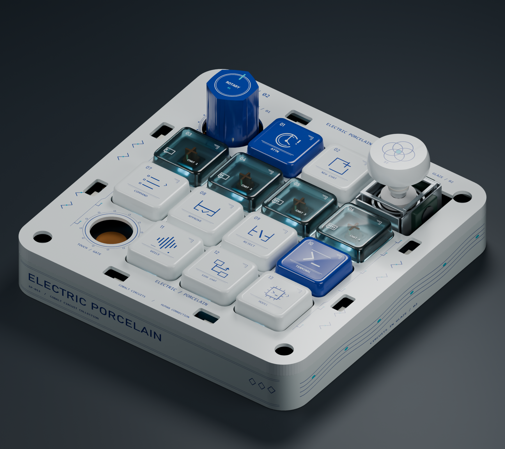
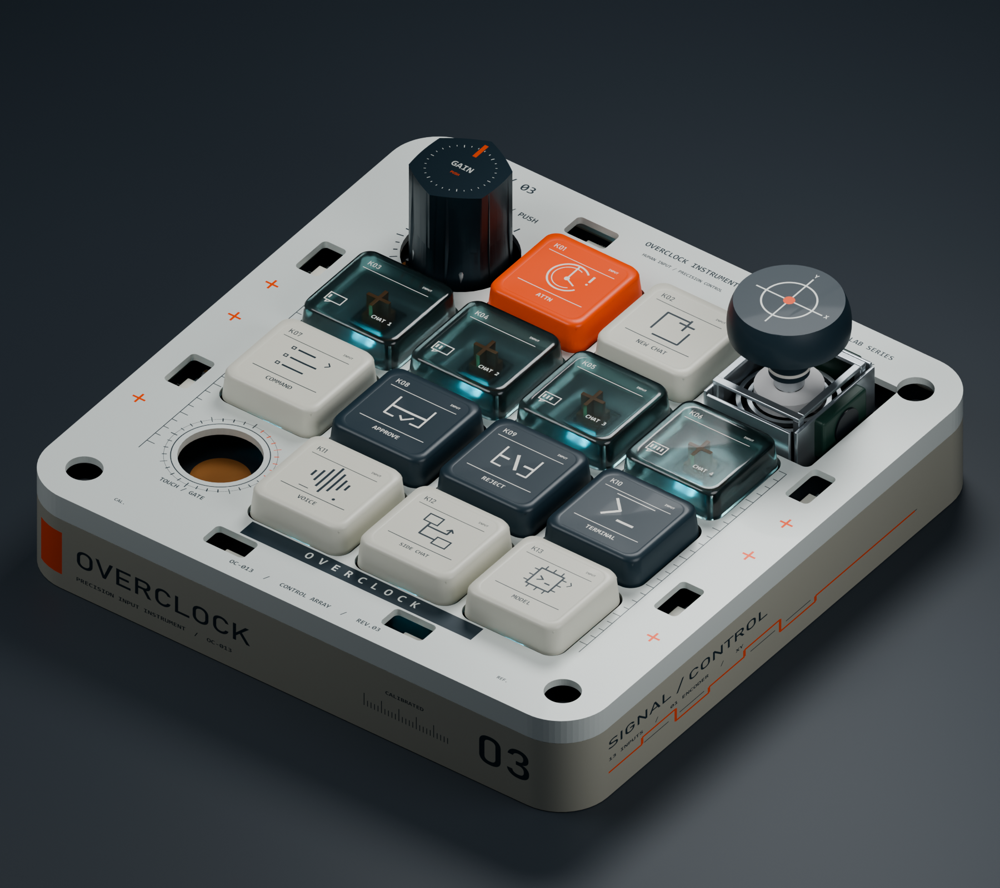
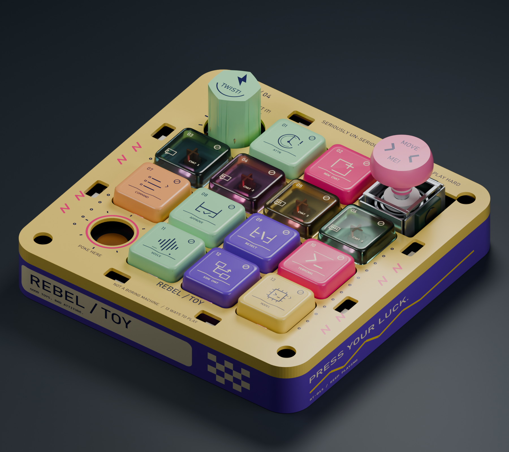

# ACID ALLOY / 酸性合金

维护者：[@mayiwei442-bojack](https://github.com/mayiwei442-bojack)

多输入桌面控制器的外观设计、Blender 装配模型与交互展示网站。包含 13 个机械按键、旋钮、摇杆、触摸输入和 RGB 灯光的结构与展示资料。

## 项目文件

| 目录 | 内容 |
| --- | --- |
| [`website/`](website/) | 五章节产品展示网站、二维交互工作台、七步制作流程演示、测试与截图 |
| [`modeling/assets/`](modeling/assets/) | Blender 主模型、四种外观方案和阶段存档 |
| [`modeling/`](modeling/) | 渲染、印花贴图、建模脚本、尺寸参考、验收记录和操作说明 |
| [`device/`](device/) | 硬件设计、制造文件、打印模型、固件与配套工具 |

## Blender 方案

| 方案 | 文件 | 预览 |
| --- | --- | --- |
| 基础装配 | [`MacroPad.blend`](modeling/assets/MacroPad.blend) | 装配、器件和交互控制 |
| 酸性合金 | [`MacroPad_AcidAlloy.blend`](modeling/assets/MacroPad_AcidAlloy.blend) |  |
| 电光瓷器 | [`MacroPad_ElectricPorcelain.blend`](modeling/assets/MacroPad_ElectricPorcelain.blend) |  |
| 超频仪器 | [`MacroPad_OverclockInstrument.blend`](modeling/assets/MacroPad_OverclockInstrument.blend) |  |
| 反叛玩具 | [`MacroPad_RebelToy.blend`](modeling/assets/MacroPad_RebelToy.blend) |  |

使用 Blender 打开 `.blend` 文件；成品印花贴图已内嵌。历史验收记录保留当时的场景名称和本机路径。

## 网站本地启动

```powershell
cd website
npm ci
npm run dev
```

浏览器打开 `http://localhost:3100`。网站目前以二维交互演示为主，正式 GLB、产品照片等素材的接入状态见 [`website/docs/assets.md`](website/docs/assets.md)。制作流程为浏览器内模拟。

## 制造资料

- [Gerber 制造文件](device/hw/v1/fab/openmicro-gerbers.zip)
- [BOM 元件清单](device/hw/v1/fab/openmicro-bom.csv)
- [SMT 贴片坐标](device/hw/v1/fab/openmicro-smt.csv)
- [打印与可编辑机械模型](device/hw/v1/mechanical/)
- [制造说明](device/hw/v1/fab/README.md)

## 许可

各部分的版权和许可见 [THIRD_PARTY_NOTICES.md](THIRD_PARTY_NOTICES.md) 与目录内的许可证。
